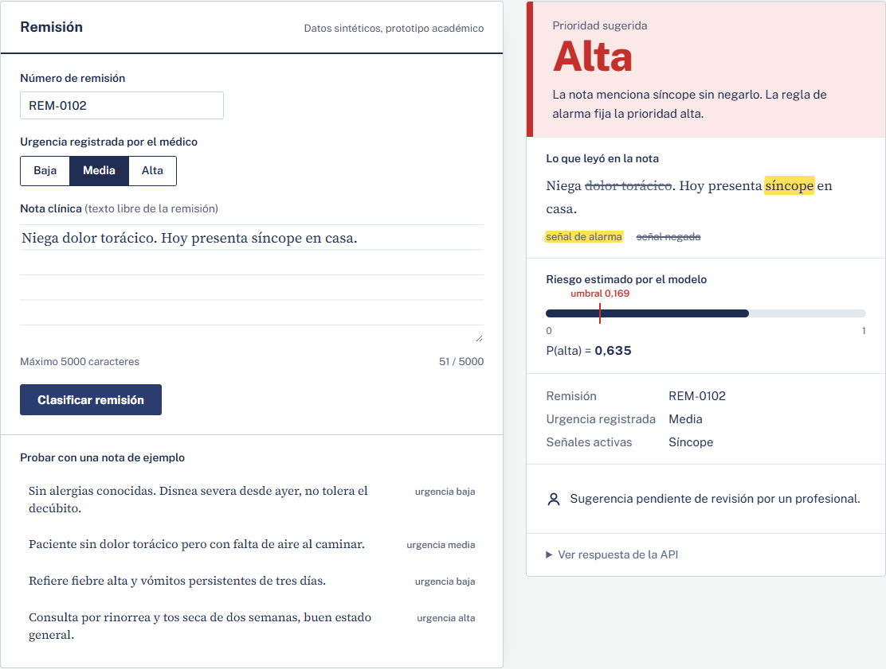
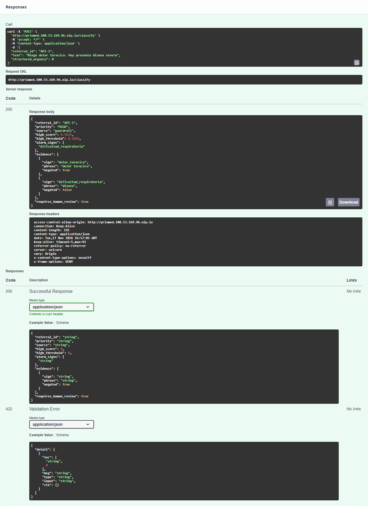
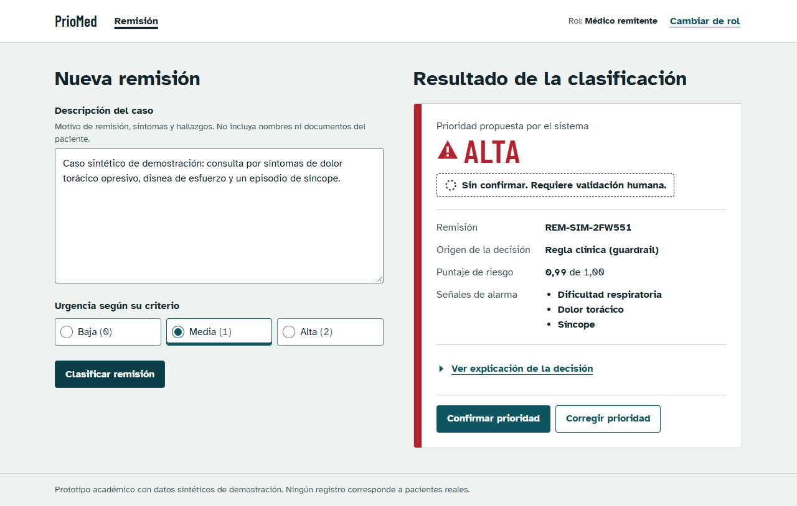

# priomed-classification-service

Servicio de clasificación de prioridad de remisiones a consulta especializada — componente
**Classification Service** de PrioMed (Secciones 5–7 del artículo del proyecto).

## Foco técnico del proyecto

> **Atributo de calidad: sensibilidad diferencial en casos de alta severidad (seguridad clínica).**
> Problema técnico: *controlar con garantía estadística la tasa de subtriaje de los casos críticos*
> (HIGH clasificado como no-HIGH), aceptando más falsas alarmas a cambio, porque los dos errores
> no cuestan lo mismo.

El estado del arte (Sección 3 del artículo) muestra que los modelos fallan justo en los casos
graves (p. ej. sensibilidad 54.2 % vs. especificidad 80.1 % en cirugía cardiaca). Este repo
implementa y evalúa tres capas para atacar ese problema:

| Capa | Módulo | Qué hace |
|---|---|---|
| Guardrail de reglas (Alternativa A) | `alarm_extractor.py` | Diccionario + manejo de negación acotado por cláusula; una señal de alarma activa fuerza prioridad HIGH |
| ML clásico (Alternativa B) | `model.py` | TF-IDF + regresión logística; P(HIGH) como puntaje de riesgo |
| Umbral Neyman–Pearson | `np_threshold.py` | Elige el umbral sobre P(HIGH) para que la tasa de omisión sea ≤ α con confianza ≥ 1 − δ |

La explicación con LLM (Alternativa C) y la validación humana viven en otros componentes; este
servicio siempre devuelve `requires_human_review = true`.

## Uso

```bash
pip install -e ".[dev]"
pytest -q                          # 23 pruebas, incluida cobertura empírica de la garantía NP
python scripts/run_evaluation.py   # comparación de 6 estrategias -> reports/evaluation_report.md
uvicorn priomed_classification.api:app --reload
```

```bash
curl -X POST localhost:8000/classify -H 'content-type: application/json' \
  -d '{"referral_id":"r1","text":"Niega dolor toracico. Hoy presenta disnea severa","structured_urgency":0}'
```

```json
{
  "referral_id": "r1",
  "priority": "HIGH",
  "source": "guardrail",
  "high_score": 0.5625,
  "high_threshold": 0.1692,
  "alarm_signs": ["dificultad_respiratoria"],
  "evidence": [
    {"sign": "dolor_toracico", "phrase": "dolor toracico", "negated": true},
    {"sign": "dificultad_respiratoria", "phrase": "disnea", "negated": false}
  ],
  "requires_human_review": true
}
```

| Campo | Significado |
|---|---|
| `priority` | `HIGH`, `MEDIUM` o `LOW` |
| `source` | `guardrail` si decidió la regla de alarma, `ml` si decidió el modelo con el umbral NP |
| `high_score` | P(HIGH) estimada por el modelo |
| `high_threshold` | Umbral Neyman-Pearson aplicado sobre P(HIGH) |
| `alarm_signs` | Señales de alarma activas (no negadas) |
| `evidence` | Cada frase de alarma encontrada, en orden de aparición, con la señal y si está negada. Sirve para explicar la decisión al revisor |
| `requires_human_review` | Siempre `true` |

La entrada se valida: `referral_id` de 1 a 64 caracteres, `text` de 1 a 5000 y
`structured_urgency` entre 0 y 2; si no, la API responde 422.

### Portal web

El portal de PrioMed vive en `priomed-infra` (`deploy/web/index.html`) y se sirve en el mismo
origen que la API. Usa `evidence` para resaltar en la nota las frases de alarma activas y tachar
las negadas, y `high_threshold` para comparar el riesgo del modelo con el umbral.



### CORS

El portal de `priomed-infra` llama la API desde el mismo origen y no necesita CORS. Para que un
frontend en otro origen (`priomed-frontend`) llame la API desde el navegador, el servicio autoriza por
defecto los orígenes `http://localhost:5173` y `http://localhost:4173`. Para otros orígenes, defina
`PRIOMED_CORS_ORIGINS` con una lista separada por comas:

```bash
PRIOMED_CORS_ORIGINS="https://priomed.example" uvicorn priomed_classification.api:app
```

## Verificación del servicio en ejecución

Los casos son sintéticos.

**`POST /classify` desde Swagger UI (`/docs`)**, servicio desplegado en EC2 (17 de noviembre de
2026). La negación de «dolor toracico» termina en el punto, así que «disnea» queda activa y fuerza
HIGH; `evidence` muestra ambas frases.



**Integración con `priomed-frontend`** (5 de octubre de 2026, versión anterior de la respuesta). El frontend, servido desde `localhost:4173`, llama a este
servicio por CORS y muestra su respuesta; la prioridad queda sin confirmar hasta la validación humana.



## Resultados preliminares (SINTÉTICOS — leer antes de citar)

Corrida por defecto (α = 0.05, δ = 0.05, semilla 7, 3000 remisiones de prueba):

| Estrategia | Sens. HIGH | Sens. desajuste | Falsa alarma HIGH | Subtriaje |
|---|---|---|---|---|
| S0 urgencia estructurada del médico | 0.755 | 0.000 | 0.038 | 0.052 |
| S1 solo reglas (A) | 0.934 | 0.827 | 0.041 | 0.030 |
| S2 ML argmax (B) | 0.899 | 0.877 | 0.005 | 0.027 |
| S3 ML + umbral NP | 0.971 | 1.000 | 0.032 | 0.017 |
| S5 guardrail + ML + NP | 0.971 | 1.000 | 0.032 | 0.017 |

Lectura honesta:

- El umbral NP sube la sensibilidad de HIGH de ~0.90 a ~0.97 y cumple la meta del Escenario 1
  (≥ 95 %), a costa de ~3 % de falsas alarmas (el ML con argmax tenía 0.5 %).
- Acotar la negación por cláusula subió la sensibilidad de solo reglas de 0.915 a 0.934 (y de
  0.741 a 0.827 en casos de desajuste): antes, un «sin alergias conocidas» ocultaba la alarma de la
  frase siguiente.
- En estos datos el guardrail **no mejora** la sensibilidad sobre ML + NP (S5 = S3). Su valor aquí
  es de **independencia y auditabilidad** (no depende del modelo), no de métrica; hay que probarlo
  con datos donde el modelo falle de verdad.
- **Limitación central:** los datos son sintéticos y las etiquetas salen de la misma taxonomía que
  usa el guardrail, así que la evaluación es en parte circular. Valida el *mecanismo* (la garantía
  NP se verifica empíricamente en `tests/test_np_threshold.py`), **no** el desempeño clínico real.
- La taxonomía motivo → severidad es una hipótesis de trabajo y requiere validación clínica.

## Próximos pasos

- Reemplazar datos sintéticos por datos abiertos / anonimizados (RIPS, SISPRO) y calibrar con el
  Anexo Técnico del MGTE.
- Medir sensibilidad por motivo de consulta y no solo agregada (el hallazgo del artículo es que el
  error es *diferencial*).
- Comparar contra clasificación jerárquica NP multiclase (ver `docs/` en `priomed-docs`).
